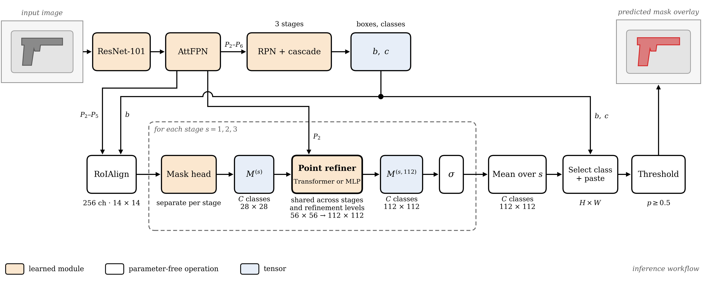
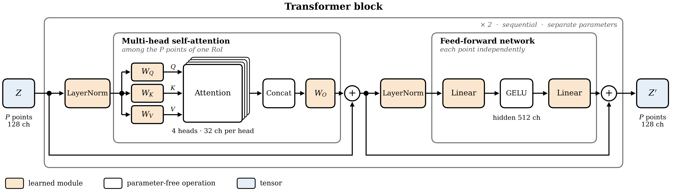
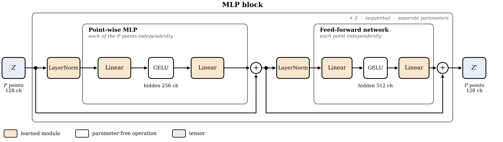

# ProposalFirst-XRaySeg

### Shared point-based mask refinement for X-ray instance segmentation

**Improving X-Ray Baggage Instance Segmentation with Shared Point-Based Mask Refinement**<br>
Abdulaziz Alqahtani and Qasim Umer

[Project page](https://pr-abdulaziz.github.io/ProposalFirst-XRaySeg/) · [arXiv:2611.20476](https://arxiv.org/abs/2611.20476) · [Project context and architecture](docs/README.md) · [Reproduction guide](docs/REPRODUCIBILITY.md) · [Checkpoint status](CHECKPOINTS.md)

This project studies whether refining uncertain mask locations improves the segmentation of prohibited items in X-ray baggage images. It extends **Cascade Mask R-CNN with ResNet-101 and AttFPN** using a shared point refiner and compares **Transformer** and **MLP** processors under a common experimental protocol.

The paper study uses the official **PIXray** split, ten configurations and three training seeds. This repository provides the implementation, frozen experiment configurations, architecture figures and the paper's results. Dataset images are excluded from Git; trained weights are on [Hugging Face](https://huggingface.co/abdulaziz-alqahtani/xray-point-refinement).

## Architecture



*Implemented inference workflow. One refiner is shared across cascade stages and refinement levels.*

For each detected instance, the model starts with a **28 × 28** coarse mask and refines it at **56 × 56** and **112 × 112**. It selects uncertain locations, combines image features with the original coarse logits and point coordinates, predicts class logits, and replaces the selected mask values. The remaining locations keep their interpolated values.

The implementation combines three design choices:

- **Selective refinement:** concentrate prediction at a subset of mask locations using existing instance-mask supervision.
- **Shared refinement:** reuse one complete refiner across three cascade stages and two refinement resolutions; keep the coarse mask heads separate.
- **Processor comparison:** compare interactions among selected points with independent point processing while retaining the same embedding, decoding, sampling and supervision design.

### Transformer and MLP processors



*Transformer: selected points exchange information within their own RoI.*



*MLP: each selected point is processed independently.*

Both variants use 128-dimensional tokens, two sequential blocks, a 512-wide feed-forward network and a class-logit decoder. See the [detailed architecture and equations](docs/README.md#architecture-and-data-flow) for the tensor shapes and parameter-sharing rules.

## Manuscript-reported results

Official PIXray test split; **1,486 images, 15 categories, seeds 42/123/2026**. Values below are mask AP points, reported as mean ± sample standard deviation in [Table 2 of the paper](https://arxiv.org/abs/2611.20476).

| Model | Mask AP | Gain over Parent |
|---|---:|---:|
| Cascade Mask R-CNN + AttFPN (Parent) | 70.50 ± 0.06 | — |
| Transformer point refiner | 71.79 ± 0.19 | +1.29 |
| MLP point refiner | **72.47 ± 0.08** | **+1.97** |

These are historical results reported in the supplied manuscript, not new measurements from a fresh repository clone. The findings concern the tested PIXray configuration: they do not establish improved clean-baggage rejection, cross-dataset generalization or higher efficiency. The refiners add computation, and the manuscript does not establish a corresponding positive detection gain. [Scope and limitations](docs/README.md#scope-and-limitations) explains the comparison boundaries.

## Start here

```bash
git clone https://github.com/pr-Abdulaziz/ProposalFirst-XRaySeg.git
cd ProposalFirst-XRaySeg

# Code/configuration contracts; no ML packages or dataset downloads required.
python -B -m unittest discover -s tests -p test_research_cli.py -v
```

Then follow the [reproduction guide](docs/REPRODUCIBILITY.md) to install the supported Linux environment and supply the external datasets and pretrained weights. A code-only clone is expected to fail the asset audit until those inputs are provided.

```bash
# After supplying the required assets:
python scripts/research.py audit --dataset pixray
python scripts/research.py prepare --dataset pixray --method 09 --seed 42 --name my_reproduction
```

`prepare` creates a new portable configuration and provenance record. It starts no training and leaves frozen experiment records unchanged. Use `09M` for the MLP variant, and read the guide before explicitly launching training or evaluation.

## Repository guide

| Location | Purpose |
|---|---|
| [Project context](docs/README.md) | Research questions, architecture, equations, baselines and experiment interpretation |
| [Reproduction guide](docs/REPRODUCIBILITY.md) | Environment, assets, audit, portable config preparation and execution workflow |
| [Custom implementation](projects/proposal_first_pidray_occ/) | Models, datasets, hooks and evaluation components |
| [Point refiners](projects/proposal_first_pidray_occ/models/point_refine/) | Sampling, embeddings, Transformer/MLP processing and cascade integration |
| [PIXray frozen campaign](output/pixray_multiseed_bs4_e50_2026-09-14/) | Three-seed paper protocol and resolved configurations |
| [Separate PIDray campaign](output/pidray_bs2_e10_2026-09-22/) | Recorded one-seed extension; separate from the paper evidence |
| [Architecture figures](docs/architecture/README_figures.md) | Existing PNG/SVG/PDF diagrams and drawing sources |
| [Project page source](site/) | Static site published with GitHub Pages by `.github/workflows/pages.yml`; preview locally with `python -m http.server --directory site` |
| [Checkpoint inventory](CHECKPOINTS.md) | Final-checkpoint identities and actual binary availability |

## Paper

The paper is available as [arXiv:2611.20476](https://arxiv.org/abs/2611.20476). Use it together with the frozen campaign when interpreting the result table above. Manuscript files are not stored in this repository.

## Citation

If you use this work, please cite the paper ([arXiv:2611.20476](https://arxiv.org/abs/2611.20476)). GitHub's "Cite this repository" button reads [`CITATION.cff`](CITATION.cff).

```bibtex
@misc{alqahtani2026improving,
  title         = {Improving X-Ray Baggage Instance Segmentation with Shared Point-Based Mask Refinement},
  author        = {Alqahtani, Abdulaziz and Umer, Qasim},
  year          = {2026},
  eprint        = {2611.20476},
  archivePrefix = {arXiv},
  primaryClass  = {cs.CV},
  doi           = {10.48550/arXiv.2611.20476},
  url           = {https://arxiv.org/abs/2611.20476}
}
```

## License and copyright

Copyright (c) 2026 Abdulaziz Alqahtani and Qasim Umer. **All rights reserved.** The manuscript, figures, project page and the authors' own code may not be copied, redistributed or republished without written permission; see [`LICENSE`](LICENSE) for the exact terms and what is allowed (viewing, GitHub forks, citation, fair use).

This repository also contains third-party code (OpenMMLab MMDetection and MMPretrain under Apache-2.0, and the Occ project under MIT) that stays under its own licenses; see [`THIRD_PARTY_NOTICES.md`](THIRD_PARTY_NOTICES.md).

## Availability and validation

- **Source/configuration integrity:** the restored paper code and all 40 frozen PIXray/PIDray resolved configs match their recorded historical hashes. Git preserves their exact bytes across operating systems.
- **Checks:** five local code/config contract tests and 23 matching-source Linux CPU runtime checks passed during the handoff. This is separate from full GPU training or native Windows CUDA validation.
- **Datasets:** excluded from Git. The maintainer's local PIXray asset audit passed; the local PIDray image copy remains incomplete. Obtain the original assets and run the audit on your own machine.
- **Weights:** excluded from Git history. The seed-42 model of each of the ten experiments is on [Hugging Face](https://huggingface.co/abdulaziz-alqahtani/xray-point-refinement) (weights only, no optimizer state). The [checkpoint release](https://github.com/pr-Abdulaziz/ProposalFirst-XRaySeg/releases/tag/paper-checkpoints-v1) lists the inventory of the 40 original checkpoints; their binaries were not uploaded.

Please refer to the linked manuscript for the study's author list, full methodology, references and interpretation. Publication metadata can be added when it is available.

## Paper results and trained models

The paper's PIXray campaign (10 experiments × 3 seeds, 50 epochs, official test split) is in [`results/`](results/README.md): COCO evaluations, raw test-set predictions, bootstrap, permutation and TOST statistics, object-level mask-quality analysis, training logs, plots and supplementary tables. Figures that show PIXray images are not included. Every statistic can be recomputed from the saved predictions without a GPU. Additional analyses (inference-time ablations, point-budget evaluation and BCa intervals) are in [`scripts/revision_2026_11/`](scripts/revision_2026_11/).

Trained weights for the seed-42 run of every experiment are on Hugging Face: [abdulaziz-alqahtani/xray-point-refinement](https://huggingface.co/abdulaziz-alqahtani/xray-point-refinement). They hold model weights only (no optimizer state), so they are for inference and fine-tuning, not for resuming training. Seed-42 mask AP is 70.48 (Parent), 71.90 (Transformer refiner) and 72.54 (MLP refiner); the table above reports the three-seed mean.

**Environment.** Linux, Python 3.10, PyTorch 2.1.2 + CUDA 11.8, torchvision 0.16.2, MMEngine 0.10.7, MMCV 2.1.0, MMDetection 3.2.0, MMPretrain 1.1.1 and pycocotools 2.0.7. The SAM-based experiments also need transformers 4.38.1 and peft 0.8.2. Exact versions are in [`environment/pip_freeze.txt`](environment/pip_freeze.txt); installation steps are in the [reproduction guide](docs/REPRODUCIBILITY.md#4-use-a-supported-execution-environment).

**Data layout.** PIXray and PIXray-A are not redistributed; obtain them from their authors.

```
data/PIXray/{train,test}/                            images
data/PIXray/annotations/{train,test}.json
data/PIXray-A/annotations/{train_occ,test_occ}.json  bilayer experiments (06, 07) only
pretrained/sam_vit_large/                            facebook/sam-vit-large, SAM experiments (05, 06) only
```

`scripts/prepare_assets.sh` downloads SAM ViT-L and creates the converted checkpoint used by the SAM experiments.

**Train and evaluate.** The resolved configs of all 30 runs are in `results/protocol/resolved_configs/<experiment>/seed_<n>.py`, with repository-relative paths. Run from the repository root and give every run a new work directory so that the historical campaign folders are not overwritten:

```bash
hf download abdulaziz-alqahtani/xray-point-refinement --local-dir checkpoints
python tools/train.py results/protocol/resolved_configs/m09m_point_refine_mlp/seed_42.py --work-dir work_dirs/my_m09m_seed42
python tools/test.py checkpoints/m09m_point_refine_mlp/config.py checkpoints/m09m_point_refine_mlp/model.pth --work-dir work_dirs/my_m09m_seed42_test
```

Training used batch size 4 for 50 epochs on one GPU with FP16 mixed precision; evaluation used FP32 at batch size 1.

**Provenance.** The files in `results/` were sanitized for release (server paths made repository-relative). The SHA-256 values inside each `eval_record.json` were recorded before that step, so they do not match the released predictions, metrics and configs byte for byte. The hash-checked frozen configs remain in [`output/pixray_multiseed_bs4_e50_2026-09-14/`](output/pixray_multiseed_bs4_e50_2026-09-14/), are verified by `tests/test_research_cli.py`, and are the ones the `scripts/research.py` workflow above uses.
