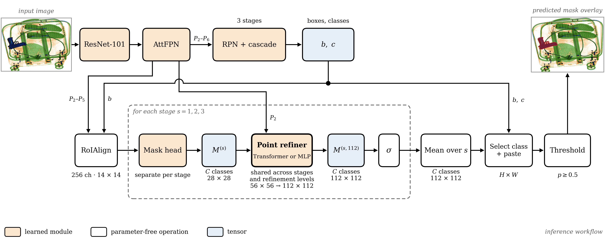
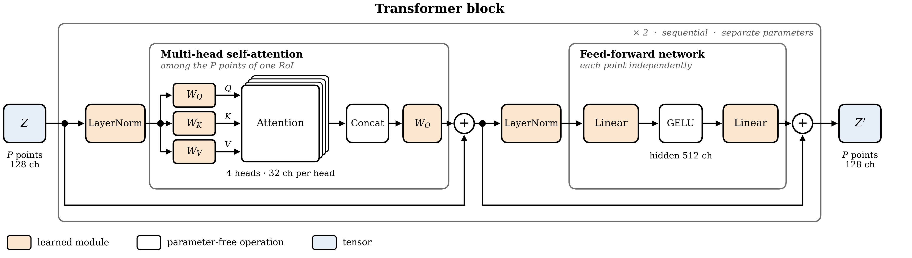
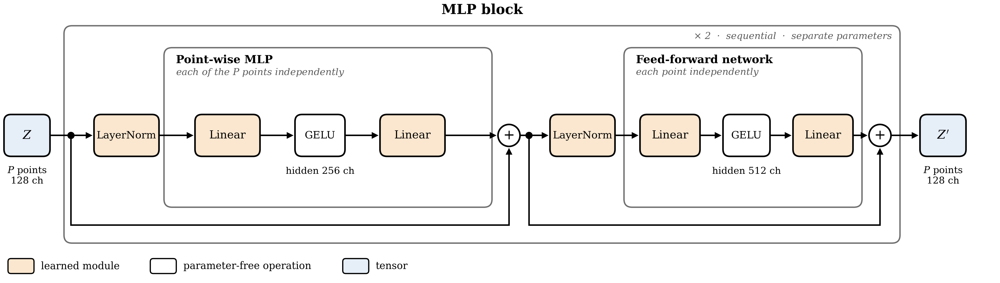

# ProposalFirst-XRaySeg

### Shared point-based mask refinement for X-ray instance segmentation

**Improving X-Ray Baggage Instance Segmentation with Shared Point-Based Mask Refinement**<br>
Abdulaziz Alqahtani and Qasim Umer

[Manuscript PDF (v2)](paper/main_paper_juri_v2.pdf) · [Project context and architecture](docs/README.md) · [Reproduction guide](docs/REPRODUCIBILITY.md) · [Checkpoint status](CHECKPOINTS.md)

This project studies whether refining uncertain mask locations improves the segmentation of prohibited items in X-ray baggage images. It extends **Cascade Mask R-CNN with ResNet-101 and AttFPN** using a shared point refiner and compares **Transformer** and **MLP** processors under a common experimental protocol.

The paper study uses the official **PIXray** split, ten configurations and three training seeds. This repository provides the implementation, frozen experiment configurations, architecture figures and supplied paper PDFs. Dataset images and large model-weight files are excluded from Git; see checkpoint status for availability.

## Architecture



*Implemented inference workflow. One refiner is shared across cascade stages and refinement levels.*

For each detected instance, the model starts with a **28 × 28** coarse mask and refines it at **56 × 56** and **112 × 112**. It selects uncertain locations, combines image features with the original coarse logits and point coordinates, predicts class logits, and replaces the selected mask values. The remaining locations keep their interpolated values.

The implementation combines three design choices:

- **Selective refinement:** concentrate prediction at a subset of mask locations using existing instance-mask supervision.
- **Shared refinement:** reuse one complete refiner across three cascade stages and two refinement resolutions; keep the coarse mask heads separate.
- **Processor comparison:** compare interactions among selected points with independent point processing while retaining the same embedding, decoding, sampling and supervision design.

### Transformer and MLP processors



*Transformer: selected points exchange information within their own RoI.*



*MLP: each selected point is processed independently.*

Both variants use 128-dimensional tokens, two sequential blocks, a 512-wide feed-forward network and a class-logit decoder. See the [detailed architecture and equations](docs/README.md#architecture-and-data-flow) for the tensor shapes and parameter-sharing rules.

## Manuscript-reported results

Official PIXray test split; **1,486 images, 15 categories, seeds 42/123/2026**. Values below are mask AP points, reported as mean ± sample standard deviation in [Table 2 of the v2 manuscript, PDF page 16](paper/main_paper_juri_v2.pdf#page=16).

| Model | Mask AP | Gain over Parent |
|---|---:|---:|
| Cascade Mask R-CNN + AttFPN (Parent) | 70.50 ± 0.06 | — |
| Transformer point refiner | 71.79 ± 0.19 | +1.29 |
| MLP point refiner | **72.47 ± 0.08** | **+1.97** |

These are historical results reported in the supplied manuscript, not new measurements from a fresh repository clone. The findings concern the tested PIXray configuration: they do not establish improved clean-baggage rejection, cross-dataset generalization or higher efficiency. The refiners add computation, and the manuscript does not establish a corresponding positive detection gain. [Scope and limitations](docs/README.md#scope-and-limitations) explains the comparison boundaries.

## Start here

```bash
git clone https://github.com/pr-Abdulaziz/ProposalFirst-XRaySeg.git
cd ProposalFirst-XRaySeg

# Code/configuration contracts; no ML packages or dataset downloads required.
python -B -m unittest discover -s tests -p test_research_cli.py -v
```

Then follow the [reproduction guide](docs/REPRODUCIBILITY.md) to install the supported Linux environment and supply the external datasets and pretrained weights. A code-only clone is expected to fail the asset audit until those inputs are provided.

```bash
# After supplying the required assets:
python scripts/research.py audit --dataset pixray
python scripts/research.py prepare --dataset pixray --method 09 --seed 42 --name my_reproduction
```

`prepare` creates a new portable configuration and provenance record. It starts no training and leaves frozen experiment records unchanged. Use `09M` for the MLP variant, and read the guide before explicitly launching training or evaluation.

## Repository guide

| Location | Purpose |
|---|---|
| [Project context](docs/README.md) | Research questions, architecture, equations, baselines and experiment interpretation |
| [Reproduction guide](docs/REPRODUCIBILITY.md) | Environment, assets, audit, portable config preparation and execution workflow |
| [Custom implementation](projects/proposal_first_pidray_occ/) | Models, datasets, hooks and evaluation components |
| [Point refiners](projects/proposal_first_pidray_occ/models/point_refine/) | Sampling, embeddings, Transformer/MLP processing and cascade integration |
| [PIXray frozen campaign](output/pixray_multiseed_bs4_e50_2026-09-14/) | Three-seed paper protocol and resolved configurations |
| [Separate PIDray campaign](output/pidray_bs2_e10_2026-09-22/) | Recorded one-seed extension; separate from the paper evidence |
| [Architecture figures](docs/architecture/README_figures.md) | Existing PNG/SVG/PDF diagrams and drawing sources |
| [Checkpoint inventory](CHECKPOINTS.md) | Final-checkpoint identities and actual binary availability |

## Paper PDFs

The current supplied manuscript is [main_paper_juri_v2.pdf](paper/main_paper_juri_v2.pdf). Its filename does not establish publication or acceptance status; no venue or DOI is asserted here. Only PDFs from `paper/` are published. Editable DOCX files and private review notes are excluded.

<details>
<summary>Earlier manuscript versions and historical reports</summary>

- [Previous manuscript PDF](paper/main_paper_juri.pdf)
- [Historical point-refinement variants summary](paper/Improving_XRay_Instance_Segmentation_Point_Refinement_Variants.pdf)
- [Historical results summary](paper/main_results.pdf)
- [Historical supplementary evaluation report](paper/PIXray_Supplementary_Evaluation_Report.pdf)
- [Earlier point-refinement report](paper/Point_Based_Mask_Refinement_XRay_Instance_Segmentation.pdf)
- [Alternate earlier point-refinement report](paper/Point_Based_Mask_Refinement_XRay_Instance_Segmentation1.pdf)

These files are retained for context. Use the v2 manuscript and the corresponding frozen campaign when interpreting the main result table above; older reports may describe earlier settings.

</details>

## Availability and validation

- **Source/configuration integrity:** the restored paper code and all 40 frozen PIXray/PIDray resolved configs match their recorded historical hashes. Git preserves their exact bytes across operating systems.
- **Checks:** five local code/config contract tests and 23 matching-source Linux CPU runtime checks passed during the handoff. This is separate from full GPU training or native Windows CUDA validation.
- **Datasets:** excluded from Git. The maintainer's local PIXray asset audit passed; the local PIDray image copy remains incomplete. Obtain the original assets and run the audit on your own machine.
- **Weights:** excluded from normal Git history. The [checkpoint release](https://github.com/pr-Abdulaziz/ProposalFirst-XRaySeg/releases/tag/paper-checkpoints-v1) currently contains the inventory only; no checkpoint binary completed the interrupted transfer.

Please refer to the linked manuscript for the study's author list, full methodology, references and interpretation. Publication metadata can be added when it is available.
