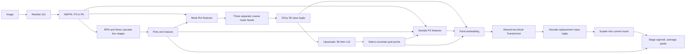

# ProposalFirst-XRaySeg: implemented architecture and entrypoints

Source review date: 2026-10-24. This document describes the cluster source
snapshot, not a claim that all dependencies, experiments or proposed changes
have passed runtime validation. Existing campaign records remain historical.

## 1. Repository map

| Location | Purpose |
|---|---|
| `projects/proposal_first_pidray_occ/` | Custom datasets, models, metrics, hooks and configs |
| `projects/proposal_first_pidray_occ/models/point_refine/` | Transformer/MLP refiners and cascade adapter |
| `configs/occlusion/` | SAM/RSPrompter and occlusion baseline configurations |
| `mmdet/`, `mmpretrain/` | Vendored detector and pretrained-model implementations |
| `scripts/campaign_multiseed/` | PIXray ten-method campaign definitions and tooling |
| `scripts/campaign_pidray_bs1/` | PIDray campaign and diagnostic tooling; directory name is historical |
| `output/<campaign>/protocol/` | Recorded manifests, resolved configs and provenance |
| `work_dirs/<campaign>/` | Training checkpoints and logs |
| `tests/`, `scripts/test_method09_integration.py` | Contract checks and GPU integration checks |

The custom package imports its datasets, metrics, hooks and model families.
Classes register with MMDetection registries; configurations use `custom_imports`.
Model-package imports include SAM-related branches, even for detector configs.
Detached and stable-inference variants require their explicit module imports.

## 2. Main detector and refinement path



The diagram shows the mask branch; box prediction remains the cascade's task.
One complete refiner is reused across three stages and both refinement levels.
The two internal Transformer blocks have separate parameters. Coarse mask heads
are separate per stage. The adapter does not construct three refiners.

Key sources: `models/attfpn.py`, `configs/pixray_09_point_refine.py`,
`models/point_refine/cascade_adapter.py` (relative to the custom project).

## 3. Essential tensor and equation contracts

For stage `s`, `N_s` is its positive training RoI count, which can differ by stage.
`C=15` for PIXray and `C=12` for PIDray; resolved configuration determines `C`.

$$F_{\mathrm{RoI}}^{(s)}\in\mathbb R^{N_s\times256\times14\times14}
\longrightarrow M_0^{(s)}\in\mathbb R^{N_s\times C\times28\times28}.$$

At each resolution `r` in `{56,112}`, interpolate the current mask, then rank
selected-class uncertainty. Use the assigned class in training and predicted
class in inference:

$$\widetilde M_r=\operatorname{Bilinear}(M_{\mathrm{previous}},r),\qquad
U_i=-|\widetilde M_{r,c}(u_i)|.$$

Selection reads this evolving mask. Token conditioning instead samples the
stage's **original** `M_0` at every level. P2 appearance has 256 channels;
coarse logits have `C` channels and normalized RoI coordinates have two:

$$z_i=\operatorname{LN}[\phi_f(f_i)+\phi_m(M_0(u_i))+\phi_u(u_i)+e_r]
\in\mathbb R^{128}.$$

Projection widths are `256→128`, `C→64→128`, and `2→128→128`.
The nonlinear branches use GELU. Stage embeddings are disabled by default.
For each of two independently parameterized blocks:

$$H_b=Z_{b-1}+\operatorname{MHSA}_b(\operatorname{LN}_{b,1}(Z_{b-1})),\qquad
Z_b=H_b+\operatorname{FFN}_b(\operatorname{LN}_{b,2}(H_b)).$$

Self-attention has four 32-dimensional heads, operates only within each RoI,
and uses no dropout. The FFN is `128→512→128` with GELU.

$$\ell_i=W_d\operatorname{LN}(z_i^{\mathrm{final}})+b_d\in\mathbb R^C.$$

Selected grid cells receive these absolute logits; they are not residual
corrections. Unselected cells retain their interpolated values.
Sources: `point_refine/embeddings.py`, `transformer.py`, `head.py`, `sampling.py`.

## 4. Training, inference and controls

- Training selects 196 unique points per positive RoI and level: 147 uncertain
  points from 588 uniform candidates, plus 49 uniform points not already chosen.
- Inference selects up to 784 points per RoI and level by uncertainty.
- Full augmented instance masks supply bilinearly sampled point targets;
  supervision uses the assigned class channel and may contain soft targets.
- The point loss averages the two levels. The cascade applies stage weights
  `(1,0.5,0.25)` once, in addition to the existing detector losses:
  `L = L_base + sum_s w_s (L_point^(s,56) + L_point^(s,112))/2`.
- At inference all stage mask heads use the final detection RoIs. Their refined
  logits are converted to probabilities, averaged, class-selected and pasted.
- `refine_enabled=False` delegates to the original cascade mask path.
- The MLP control replaces only the attention sublayer with a pointwise
  `128→256→128` MLP; embedding, FFN, decoding and supervision remain shared designs.
- Detached variants in `point_refine/detached.py` detach sampled P2 features and
  coarse logits before their projections. The detector still trains with its
  own losses. This is not a frozen detector and does not remove shared clipping.

Other families include `PIDrayCascadeRCNN` with the R0/R1 presence gate,
`BilayerCascadeRoIHead`/`BilayerFCNMaskHead`, and SAM prompt/occlusion hybrids.
`ProposalFirstPIDrayOcc` and `ProposalFirstCascadeRoIHead` describe the hybrid
branch, not the current point-refinement path. Bilayer baselines additionally
use occluder supervision; they are not supervision-identical controls.

## 5. Campaign and evaluator boundaries

Use each campaign's `campaign_common.py`, manifest and resolved config as the
protocol authority. Source constants currently identify:

| Campaign | Methods | Seeds | Batch / epochs |
|---|---|---|---|
| `pixray_multiseed_bs4_e50_2026-09-14` | Ten, including Transformer and MLP | 42, 123, 2026 | 4 / 50 |
| `pidray_bs2_e10_2026-09-22` | Same ten architectures, PIDray configuration | 42 | 2 / 10 |

The `campaign_pidray_bs1` directory and its introductory comments predate its
current batch-2/10-epoch constants. PIDray training references the recorded
de-leaked annotations; resolve split amendments through its campaign records.
The root README's eleven-arm/60-epoch launchers and `registry_seven.py` are
legacy interfaces, not substitutes for these manifests. Old launcher arguments
include archived names rejected by the active registry.

The legacy PIDray `evaluate_run.py` imports a scorer that writes contiguous
labels directly as category IDs. Use the mapped scoring/diagnostic path and its
MMDetection cross-check instead. Preserve old outputs, label rescoring provenance,
and compute pooled PIDray AP from combined predictions, not averaged split AP.

## 6. Opt-in stable inference selection

The original selector subtracts `flattened_index * dtype.eps` before `topk`.
This can reorder unequal uncertainties. `stable_inference.py` instead uses a
stable descending sort, preserving ascending grid-index order only for ties.
Its classes add no state-dict keys and delegate training to the original heads.

For a **new diagnostic config**, preserve all existing imports and settings,
append this module to `custom_imports.imports`, and change this verified field:

```python
module = "projects.proposal_first_pidray_occ.models.point_refine.stable_inference"
# Append `module` to the existing custom_imports.imports; retain other imports.
model["roi_head"]["point_refine_head"]["type"] = "PointRefineHeadStableInference"
```

Use `PointRefineMLPHeadStableInference` for the MLP control, or
`PointRefineHeadDetachedStableInference` / `PointRefineMLPHeadDetachedStableInference`
for the corresponding detached variants. Keep the resolved `num_classes`.
Use a new config/output identity; do not rewrite frozen defaults or checkpoint
records. Compatible state-dict structure does not make changed inference scores
historically interchangeable. The regression file is
`tests/test_point_refine_stable_inference.py`; runtime results are recorded separately.

### Optional FP32 prediction with upstream autocast

Legacy refinement can fail under CUDA autocast when point sampling returns FP32
values for a half-precision destination. The stable selector alone does not fix
that dtype mismatch. `point_refine/fp32_inference.py` provides separate types:
`PointRefineHeadFP32Inference`, `PointRefineMLPHeadFP32Inference`,
`PointRefineHeadDetachedFP32Inference`, and `PointRefineMLPHeadDetachedFP32Inference`.
Import that module explicitly and use the same `point_refine_head.type` field.
These types retain stable selection but promote prediction inputs to FP32 and
disable autocast inside refinement; output logits are FP32, including empties.
Keep head weights FP32; `model.half()` is rejected for prediction. Training is
inherited unchanged: this is not an AMP-training repair or a validation claim.
Use a separate diagnostic identity and `tests/test_point_refine_fp32_inference.py`.

## 7. Proposed context architecture: not yet implemented

The local `docs/architecture/context_refiner_proposal_2026-10-20.md` specifies
49 context samples, cross-attention between self-attention and FFN, optional
soft foreground/background priors, and a frozen-Parent diagnostic design.
None of those context modules is present in the reviewed point-refiner source.
The detached implementation is not that frozen-Parent experiment. Treat the
proposal as a separate candidate requiring implementation, controlled comparisons
and validation across datasets; source inspection establishes no accuracy gain.
