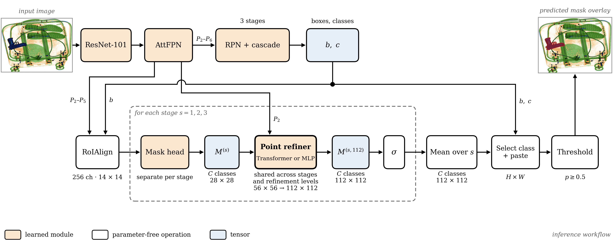
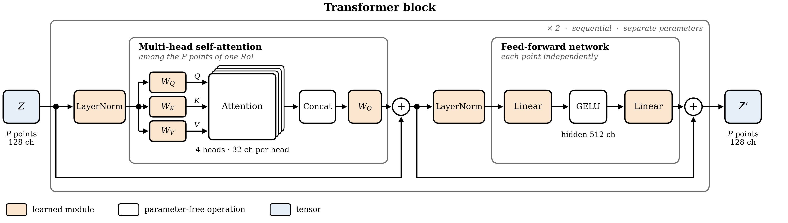
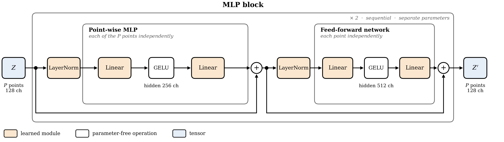

# Project context and technical guide

[Repository home](../README.md) · [Manuscript PDF (v2)](../paper/main_paper_juri_v2.pdf) · [Reproduce the experiments](REPRODUCIBILITY.md) · [Checkpoint status](../CHECKPOINTS.md)

This guide connects the research question, implemented model and experiment records. It describes the shared point-refinement study in the supplied manuscript, **Improving X-Ray Baggage Instance Segmentation with Shared Point-Based Mask Refinement**, by Abdulaziz Alqahtani and Qasim Umer. Equations and implementation contracts are grounded in the code; the reported performance numbers come from the manuscript. The separate PIDray campaign and older prototype branches have their own boundaries.

## Research question

Overlapping projections and complicated item contours make accurate instance masks difficult in X-ray baggage imagery. A coarse region mask can miss boundary detail even when its object has been detected. The study asks:

1. Does shared progressive refinement improve masks relative to the unrefined cascade Parent under the same target-mask supervision?
2. Do selected points benefit from Transformer interactions compared with independent MLP processing?
3. Do the observed gains describe better delineation, better detection, or both?

The implementation follows the point-based refinement principle: increase spatial mask resolution while decoding new logits at a selected set of locations. It does not add annotations for those points; their supervision is sampled from the existing instance masks.

## Paper scope and data

The paper evaluates ten configurations on the official **PIXray** split:

| Split | Images | Annotated instances |
|---|---:|---:|
| Training | 3,560 | 10,709 |
| Test | 1,486 | 4,508 |

There are 15 prohibited-item categories. Every PIXray image in this study contains an annotated prohibited item. The original category, box and target-mask annotations remain the evaluation targets. PIXray-A supplies auxiliary occluder masks only for the two occlusion-aware baseline adaptations; the proposed refiners use the original target-instance masks.

PIDray is a **separate repository campaign**, configured for 12 categories and a recorded leakage-filtered training set. It is not additional evidence in the supplied PIXray-only manuscript. Its Easy/Hard/Hidden split amendments, precision, schedule and evaluation conventions must be read from its own records. Datasets are external assets and are not committed to this repository.

## Architecture and data flow

*End-to-end inference architecture; the coarse heads are separate and the complete refiner is shared.*

The main path is:

**Image → ResNet-101 → AttFPN → RPN and three-stage cascade → coarse instance masks → shared point refinement → stage-probability aggregation → final instance masks.**

1. **Feature extraction.** An ImageNet-initialized ResNet-101 feeds AttFPN, which produces five 256-channel feature levels P2–P6. The point refiner samples the finest P2 features (stride 4). The stem and first residual stage follow the recorded freezing policy, and backbone BN running statistics stay fixed. This is joint detector/refiner training, not a frozen-detector experiment.
2. **Instance proposals.** The RPN and three cascade stages provide boxes and classes. Each cascade stage has its own coarse mask head. During training each stage uses its assigned positive RoIs; their counts can differ.
3. **Coarse masks.** Mask RoI features of shape `[N_s, 256, 14, 14]` are mapped to class-specific logits `[N_s, C, 28, 28]`.
4. **Progressive refinement.** Upsample the current logits to 56 × 56, select points and predict replacement logits, then repeat at 112 × 112.
5. **Final masks.** At inference all stage mask heads process the same final detected RoIs. Refine each stage, apply sigmoid separately, average probabilities, select the detected-class channel, paste into the detection box and threshold at 0.5.

Here `N_s` is the positive training-RoI count at stage `s`. `C=15` for PIXray and `C=12` for PIDray; it is a configuration value, not a hard-coded requirement of the decoder.

### Keep the two mask inputs distinct

| Operation | Mask it reads |
|---|---|
| Point selection | Current upsampled mask, including earlier refinement updates |
| Coarse-logit embedding | Original stage-specific 28 × 28 coarse mask |
| Dense mask update | Current upsampled mask, with selected cells replaced |

For refinement resolution `r`:

$$
\widetilde M_r=\operatorname{Bilinear}(M_{\mathrm{previous}},r),
\qquad U(u)=-|\widetilde M_{r,c}(u)|.
$$

The selected class `c` is the assigned ground-truth class during training and the predicted class at inference. Logits close to zero are uncertain foreground/background decisions.

The historical inference selector also contains a numerical index-dependent ranking adjustment. It must not be described as a mathematically harmless tie-only rule. The optional `stable_inference.py` implementation changes that behavior for a separately identified diagnostic; it is not silently substituted into frozen results.

### Point selection and supervision

Budgets apply **per RoI, cascade stage and refinement level**: training uses positive RoIs; inference uses final detection RoIs.

| Phase | Sampling |
|---|---|
| Training | 196 unique points: retain 147 uncertain points from 588 uniformly sampled candidates, then sample 49 additional unselected locations uniformly |
| Inference | Request 784 uncertainty-selected grid locations |

Targets are bilinearly sampled from the augmented full-resolution instance mask before its reduction to coarse RoI targets. They may therefore be soft values near boundaries. The detector's existing losses remain in place.

## Point embeddings and processors

For one selected point, sample P2 appearance `f_i`, original coarse logits `m_i^0`, normalized RoI coordinates `u_i`, and the refinement-level embedding `e_r`:

$$
z_i=\operatorname{LN}\!\left[
\phi_f(f_i)+\phi_m(m_i^0)+\phi_u(u_i)+e_r
\right]\in\mathbb R^{128}.
$$

| Input | Projection |
|---|---|
| P2 appearance | `256 → 128` |
| Original all-class coarse logits | `C → 64 → 128` |
| RoI-relative coordinates | `2 → 128 → 128` |
| Refinement level | Learned 128-dimensional embedding |

The nonlinear branches use GELU. Sum the projected 128-dimensional terms, not their differently sized raw inputs. Cascade-stage embeddings are disabled in the frozen primary configs.

### Transformer processor

For each of two sequential blocks with separate parameters:

$$
H_b=Z_{b-1}+\operatorname{MHSA}_b(\operatorname{LN}_{b,1}(Z_{b-1})),
$$

$$
Z_b=H_b+\operatorname{FFN}_b(\operatorname{LN}_{b,2}(H_b)).
$$

Self-attention has four heads with 32 channels per head. It exchanges information only among the selected points of **one RoI**. The FFN is `128 → 512 → 128` with GELU; dropout is zero. Residual paths bypass the complete normalized sublayer.

### MLP control

The MLP control replaces the attention sublayer with an independent `128 → 256 → 128` pointwise MLP. It preserves the embedding, FFN, decoder, selection procedure and supervision design. These processors are closely capacity matched; they do not have exactly identical parameter counts or computational cost.

The experiment concerns the role of interactions among selected points. It does not reproduce every design choice of an established external refinement system.

### Decoder, mask replacement and sharing

A final LayerNorm and linear decoder emit `C` logits:

$$
\ell_i=W_d\operatorname{LN}(z_i^{\mathrm{final}})+b_d.
$$

At a selected location, replace the interpolated value with the decoded logit. Retain interpolation elsewhere. **Internal residual connections do not turn this mask update into an additive correction.**

One complete refiner is shared across all three cascade stages and both refinement levels. The two internal processor blocks have distinct parameters; the three coarse mask heads are separate.

## Training objective

For stage `s` and refinement level `r`, the point loss averages binary cross-entropy over the selected points of positive RoIs, using the assigned class channel and sampled target-mask values:

$$
L_{s,r}=\frac{1}{N_s P}\sum_{k=1}^{N_s}\sum_{i=1}^{P}
\operatorname{BCEWithLogits}(\ell_{s,k,r,i}[c_{s,k}],y_{s,k,r,i}).
$$

A stage with no positive RoIs contributes zero point loss. The complete objective is:

$$
L=L_{\mathrm{base}}+\frac12\sum_{s=1}^{3}w_s(L_{s,56}+L_{s,112}),
\qquad (w_1,w_2,w_3)=(1,0.5,0.25).
$$

Stage weights are applied once. The detector retains its classification, box, RPN and coarse-mask losses. The refiner is trained jointly; point-loss gradients can affect sampled image features and coarse logits. Matched seed numbers do not guarantee identical augmentation streams across different architectures.

## Compared configurations

The ten configurations include Mask R-CNN and Cascade Mask R-CNN with FPN; the AttFPN Parent; its recall-RPN and image-level R0/R1 adaptations; RSPrompter-style SAM/LoRA; occlusion-aware bilayer SAM; bilayer FCN; and the Transformer/MLP refiners. Only the two bilayer occlusion-aware baselines receive auxiliary occluder-mask training supervision. The published-method adaptations should be interpreted under the common implementation protocol, not as reproductions of their original authors' best results.

See the [method/configuration table](REPRODUCIBILITY.md#1-understand-the-scope) for source paths. Frozen resolved configs and manifests, rather than historical launcher defaults, define the actual runs.

| Setting | PIXray paper campaign | Separate PIDray campaign |
|---|---|---|
| Configurations / runs | 10 / 30 | 10 / 10 |
| Seeds | 42, 123, 2026 | 42 |
| Batch / epochs | 4 / 50 | 2 / 10 |
| Precision | Historical training AMP float16 | FP32 |
| Warm-up | 25 iterations | 500 iterations |
| Optimizer | AdamW, learning rate 1e-4, weight decay 0.05 | Same |
| Gradient clipping | Global L2 norm 1.0 | Same |
| Checkpoint rule | Final epoch; no validation selection | Same |

Both campaigns preserve their own preprocessing, point-sampling seeds and annotation decisions. The older eleven-method/60-epoch interfaces remain legacy source dependencies and are not interchangeable protocols.

## Findings and interpretation

The [v2 manuscript, Table 2, PDF page 16](../paper/main_paper_juri_v2.pdf#page=16) reports:

| Model | PIXray mask AP, mean ± sample SD | Gain over Parent |
|---|---:|---:|
| Parent | 70.50 ± 0.06 | — |
| Transformer point refinement | 71.79 ± 0.19 | +1.29 |
| MLP point refinement | 72.47 ± 0.08 | +1.97 |

These summarize the original three-seed study, not an evaluation of the newly repaired local copy. The reported MLP mean is highest among these tested configurations. Interpretation also requires the matched-object/boundary and detection diagnostics in the manuscript; a higher aggregate mask AP alone does not identify the mechanism causing the gain.

## Code map

Paths below are relative to the repository root:

| Responsibility | Main implementation |
|---|---|
| Progressive refinement, point supervision | [`head.py`](../projects/proposal_first_pidray_occ/models/point_refine/head.py) |
| Point-token inputs and projections | [`embeddings.py`](../projects/proposal_first_pidray_occ/models/point_refine/embeddings.py) |
| Transformer processor and decoder | [`transformer.py`](../projects/proposal_first_pidray_occ/models/point_refine/transformer.py) |
| MLP processor | [`mlp_control.py`](../projects/proposal_first_pidray_occ/models/point_refine/mlp_control.py) |
| Selection, interpolation and replacement scatter | [`sampling.py`](../projects/proposal_first_pidray_occ/models/point_refine/sampling.py) |
| Cascade integration and inference averaging | [`cascade_adapter.py`](../projects/proposal_first_pidray_occ/models/point_refine/cascade_adapter.py) |
| Attention feature pyramid | [`attfpn.py`](../projects/proposal_first_pidray_occ/models/attfpn.py) |
| Audit / portable preparation | [`scripts/research.py`](../scripts/research.py) |
| PIXray experiment tooling | [`scripts/campaign_multiseed/`](../scripts/campaign_multiseed/) |
| PIDray tooling and corrected evaluation paths | [`scripts/campaign_pidray_bs1/`](../scripts/campaign_pidray_bs1/) |

The SAM/hybrid modules retained elsewhere in the project support baseline and historical branches. They should not be confused with the paper's shared point refiner. The retired guided-context/Mask2Former experiments do not define the architecture documented here.

## Reproduction workflow

1. Read the [v2 manuscript](../paper/main_paper_juri_v2.pdf) and choose a paper configuration.
2. Clone the code and run the five standard-library [contract tests](../tests/test_research_cli.py).
3. Create the documented Linux Python/CUDA/MMCV environment. Run the CPU/GPU checks described in the [reproduction guide](REPRODUCIBILITY.md#4-use-a-supported-execution-environment).
4. Obtain the datasets and pretrained weights externally; preserve their annotation semantics and recorded hashes.
5. Run `python scripts/research.py audit --dataset pixray`. Missing or zero-byte assets block preparation.
6. Run `prepare` with a fresh reproduction name. It rebases project-root paths and writes provenance without changing the frozen config.
7. Explicitly start training in the appropriate GPU environment; inspect a complete first epoch and actual update accounting.
8. Evaluate the matching final checkpoint into a new output directory, preserving category mapping, image coverage and scorer conventions. Record whether official or corrected zero-ID matching was used.

A fresh clone has no dataset images or pretrained weights, so asset readiness is expected to fail until these inputs are supplied. Historical cluster-oriented guards retain absolute path assumptions; the portable helper handles a new local-root configuration instead of rewriting old records.

For PIDray, use actual dataset label-to-category mapping and the recorded Easy-split amendment. Compute pooled AP from the combined predictions/ground truth, not a weighted average of split AP. Keep PIDray results separate from PIXray. See [evaluation instructions](REPRODUCIBILITY.md#6-evaluate-carefully) before using a legacy entry point.

## Scope and limitations

- The supplied paper's experimental claim is PIXray-only. It does not establish scanner/site transfer or independent-benchmark generalization.
- The all-positive dataset cannot establish rejection of clean baggage or background-only images. Mask spill and false detection boxes are distinct errors.
- A mask refiner operating on detected RoIs cannot reconstruct an object that has no usable detection. The manuscript does not establish a corresponding positive detection gain.
- Higher mask resolution does not by itself prove better small-object recall. The manuscript reports mixed category/size outcomes and no Dart AP improvement.
- The refiners add parameters/computation and reduce the measured end-to-end throughput. Do not claim simultaneous accuracy and efficiency improvements. That throughput measurement includes loading, inference, scoring and writing; it is not model-only latency.
- Selection strategy, resolution, parameter sharing and point-loss contributions were not individually isolated by this processor comparison.
- Extra supervision and implementation adaptations limit how the baseline rankings should be generalized.

## Reproducibility status

During the local handoff, 411 missing/empty source/config files were restored. All 40 frozen configs and both historical source snapshots matched their recorded hashes. Five local contract tests and 23 checks on the matching-source Linux CPU runtime passed. The portable parser matched MMEngine's values for all 40 configs.

These checks establish the tested source/config and bounded runtime contracts. They are separate from new full-model GPU training, a fresh accuracy evaluation and native Windows CUDA validation. The supplied paper PDFs are now included; editable DOCX and review notes stay local. The maintainer's local PIDray image copy and some historical metric/report payloads remain incomplete. No missing labels, images or metrics were fabricated.

Datasets, local checkpoint directories, ignored cleanup archives and repair logs are intentionally absent from the public Git tree. Maintainer-local receipts live under `output/repair_2026-11-06/` and `output/cleanup_2026-11-06/`. [Checkpoint status](../CHECKPOINTS.md) records the separate inventory-only release and the interrupted binary transfer.

## Extending the study

Keep frozen files and original evaluation records unchanged. Create a new module/config and experiment identity; state the intended difference, supervision and training budget; validate coordinates, class mapping, empty images, losses and updates; and compare matched controls across seeds. The optional stable/FP32-inference compatibility heads described in the [runtime audit](PROJECT_RUNTIME_AUDIT_2026-10-24.md) must be labelled as separate inference changes.

Use the [architecture figure index](architecture/README_figures.md) to locate editable SVGs and drawing scripts. Prefer the corrected figures for the implemented point-refinement path. The project documentation is intended to make the evidence traceable rather than to treat every retained prototype as part of the paper method.
